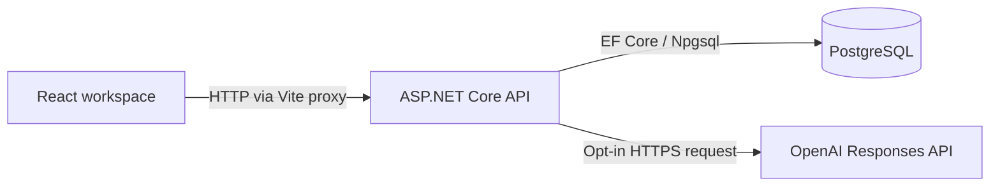

# Twiggle

**Find the connections in your experience.**

Twiggle is a personal software engineering project exploring **AI-assisted career exploration**. It uses conversation, summaries, and focused questions to help people understand their experiences before deciding what comes next.

**Work in progress:** the current local prototype supports experience capture, AI-generated follow-ups, source-linked candidate facts, human review, and PostgreSQL persistence. Transferable-skill discovery, a Personal Knowledge Graph, and career-direction analysis are part of the vision—not completed features.

[Getting Started](#getting-started) · [AI Interaction Design](#ai-interaction-design) · [System Architecture](#system-architecture) · [Roadmap](#roadmap) · [Privacy & Security](#privacy--security)

## Why I Built Twiggle

My own career path has not been linear. I have studied and worked across different fields before gradually moving into software engineering. Along the way, I found that choosing a professional direction involves much more than matching a previous job title to the next one.

A person’s background includes education, work, interests, practical abilities, and choices made under different circumstances. Experiences that look unrelated on a CV may share useful ways of thinking, solving problems, or working with others. Those connections are often difficult to recognize and articulate.

I started Twiggle to explore a question that matters to me personally: **how can software help someone find a meaningful direction within a complex professional history?**

The name evokes building a nest one twig at a time. A clearer understanding of ourselves can grow from small, concrete experiences rather than a single definitive assessment.

## The Problem

Job titles, keyword matches, and role requirements are useful ways to describe employment opportunities. They provide a less complete picture of how a person reached their current abilities—or where those abilities might transfer.

Someone may describe a substantial piece of work as “I helped with testing” without explaining the tools they built, the decisions they made, or the failures they investigated. Rewriting that sentence into more polished language does not recover the missing understanding.

Twiggle starts with the experience itself:

- What actually happened?
- What did this person do, as distinct from the team?
- Which decisions, constraints, and outcomes shaped the work?
- What remains unclear, and what would be useful to explore next?

These questions are particularly relevant to people changing fields or making sense of a non-linear career.

## Product Vision

The long-term goal is a workspace for continuous career exploration: build an account of past experience, investigate transferable capabilities, explore possible directions, and revisit assumptions as circumstances change.

The design follows four principles:

1. **Start with the person’s experience.** A role description should not determine what the person is assumed to have done.
2. **Use AI to support reflection.** Summaries and questions should help users think, while leaving choices with them.
3. **Keep interpretations traceable and revisable.** Users should be able to inspect the original account, challenge wording, and correct records.
4. **Treat exploration as ongoing.** A career model should evolve rather than become a permanent label.

Twiggle is not designed to predict someone’s career future, provide psychological assessment, or decide which path they should take. Job matching and CV generation are possible later applications of the underlying experience model.

## Current Features

The repository currently implements the following local workflow:

| Area | Implemented behavior |
| --- | --- |
| Interview sessions | Create, list, reopen, and continue a titled session. |
| Original answers | Save append-only answers before any AI generation. Add new answers to clarify earlier statements. |
| AI interaction | With a configured API key and session opt-in, request a summary, a follow-up question, and a short explanation of why it is being asked. |
| Candidate facts | Extract up to five candidate statements per response, with a source-answer ID and an exact supporting quote. |
| Human review | Edit statements and mark them Pending, Accepted, or Disputed. AI-origin labels remain visible. |
| Review history | Persist earlier statement text and review status as claim revisions. |
| Experience Bank | Save a session as an experience after at least one fact is accepted; reopen its facts and sources. |
| Recovery | Preserve saved answers when generation fails; provide explicit follow-up retry and stale-write conflict messages. |
| Local diagnostics | Display API and database connection status independently. |

The interface includes Home, Discover, and Experience Bank. **Capabilities and Settings are placeholder pages**, not functioning capability analysis or privacy-management tools. Saving an experience does not produce a complete professional profile.

## AI Interaction Design

### From an answer to the next question

The browser first sends the original answer to the backend for persistence. If the user has enabled AI for the session, it then requests a follow-up. The backend constructs the context, calls OpenAI, validates the response, and saves the AI reply separately from the user’s words.

The response contains:

- A short summary.
- A next-question field.
- A reason for the question.
- Zero to five candidate facts with source references and verbatim quotes.

The prompt asks for one focused, neutral question at a time. It prioritizes unclear ownership, concrete actions, system behavior, decisions, failures, and outcomes. It instructs the model to respect uncertainty, skipped topics, fatigue, and requests to stop. These are **prompt-level design constraints**; their conversational quality still needs evaluation with real users.

UI labels are English. The prompt asks the model to respond in the language of the latest user answer while preserving technical names.

### Context management

Each generation request includes the current session’s title, saved answers, factual statements with their review statuses, and previous AI summaries/questions. The latest answer is identified explicitly. Current reviewed corrections are included so later questioning can take them into account.

This is application-managed session context. There is no vector retrieval, cross-session personal memory, automatic context compaction, or dedicated coverage-planning engine. A character-based context limit rejects oversized sessions explicitly rather than silently discarding earlier answers.

### Structured output and review boundaries

The backend requests a strict JSON schema through the OpenAI Responses API. Application checks validate required fields, length/count limits, source membership, and whether each quoted passage occurs in the cited original answer.

**A matching quote establishes a valid citation, not a correct interpretation.** Candidate statements remain Pending until reviewed. Accepting a statement records the user’s endorsement; it does not independently verify the event or establish a skill.

Successful replies are stored against their source answer and reused on retry. Model ID, prompt-policy version, and session revision are recorded. Saved summaries remain historical drafts; they are not automatically regenerated after a later fact correction.

## System Architecture

Twiggle currently consists of a React single-page application, one ASP.NET Core API project, and PostgreSQL. Business responsibilities are organized into classes within the API; the more extensive module boundaries in the design documents remain a proposed direction.



The API owns persistence, revision checks, AI context construction, response validation, and review transitions. The browser never receives the provider key. AI responses are returned as complete results; token streaming and a durable background-generation queue are not implemented.

### Persisted model

| Entity | Purpose |
| --- | --- |
| `InterviewSession` | Session title, local workspace identifier, creation time, and concurrency revision. |
| `InterviewTurn` | Original user answer and timestamp. |
| `ExperienceClaim` | Factual statement, source-answer reference, optional source quote, origin, and review status. |
| `ClaimRevision` | Historical wording and review state associated with a session revision. |
| `AiReply` | Summary, next question, question rationale, model/policy metadata, and external-processing permission timestamp. |
| `ExperienceEpisode` | Saved-experience record linked to its session. |

An episode currently uses its session’s title and current claims. It is not an immutable report snapshot. A `WorkspaceId` is present, but all use is scoped to one development workspace; multi-user identity and isolation are not implemented.

### API surface

| Method | Endpoint | Responsibility |
| --- | --- | --- |
| `GET`, `POST` | `/api/sessions` | List or create sessions. |
| `GET` | `/api/sessions/{id}` | Retrieve answers, claims, revisions, and AI replies. |
| `POST` | `/api/sessions/{id}/turns` | Save an original answer. |
| `POST` | `/api/sessions/{id}/follow-up` | Generate or reuse a saved AI follow-up. |
| `POST` | `/api/sessions/{id}/claims` | Add a manually authored candidate fact. |
| `PUT` | `/api/sessions/{id}/claims/{claimId}` | Edit or review a fact. |
| `POST` | `/api/sessions/{id}/episode` | Save the experience to the bank. |
| `GET` | `/api/experiences` | List saved experiences. |
| `GET` | `/api/ai/status` | Report configuration presence and model ID, without exposing the key. |
| `GET` | `/api/health/live`, `/api/health/ready` | Check API liveness and database connectivity. |
| `GET` | `/api/workspace` | Describe the local development workspace. |

## Technical Stack

| Layer | Currently used |
| --- | --- |
| Frontend | React 19, TypeScript 6, Vite 8, React Router 7, browser Fetch API, custom CSS. |
| Backend | C#, .NET 10, ASP.NET Core Minimal APIs, dependency injection, `HttpClient`, `System.Text.Json`. |
| AI integration | OpenAI Responses API over HTTPS with JSON Schema output; configurable model ID, currently defaulting to `gpt-4.1` in code. |
| Persistence | PostgreSQL 17 container, Entity Framework Core 10, Npgsql provider, EF Core migrations. |
| Local configuration | PowerShell scripts, .NET User Secrets, environment variables, ignored `.env` for database configuration. |
| Verification | TypeScript compilation, Oxlint, .NET fixture-based AI checks, Python HTTP integration tests. |
| CI | GitHub Actions with a PostgreSQL service container. |

The current implementation does not use Tailwind, TanStack Query, Neo4j, an AI agent framework, or a cloud deployment. Some of these or alternative approaches appear in earlier design proposals; those documents should be read as plans, not inventories of shipped dependencies.

## Getting Started

The supplied startup scripts target **Windows PowerShell**.

### Prerequisites

- Git.
- **Node.js 24** and npm; the frontend declares Node `>=24 <25`.
- **.NET 10 SDK**, not only the runtime.
- Docker Desktop running with Linux containers and Docker Compose.
- An OpenAI API key with access to a compatible model, **only if you want AI follow-ups**. Manual capture works without it.

### 1. Clone and configure the local database

```powershell
git clone https://github.com/huizi135/Twiggle.git
Set-Location Twiggle
Copy-Item .env.example .env
notepad .env
```

Replace the example value of `TWIGGLE_DB_PASSWORD` with a local development password. Keep `.env` out of Git. For an existing checkout, update with `git pull --ff-only` after checking local changes, and keep your existing `.env`.

### 2. Start PostgreSQL

From the repository root:

```powershell
docker compose up -d --wait
docker compose ps
```

PostgreSQL is exposed at `127.0.0.1:54329`, with database/user `twiggle`. Its data is stored in a named Docker volume. Keep Docker Desktop running.

### 3. Configure AI (optional)

```powershell
powershell -NoProfile -ExecutionPolicy Bypass -File .\scripts\configure-ai.ps1
```

Enter the API key at the hidden prompt. Press Enter to keep the default model or enter another compatible model available to your API project. The script stores the settings in .NET development User Secrets outside the repository. A configured key does not itself prove model access or a successful provider connection.

The server also accepts `AI__ApiKey` or `OPENAI_API_KEY`, and an optional `AI__Model`, as environment variables. Do not put a key in frontend configuration.

### 4. Start the API

```powershell
powershell -NoProfile -ExecutionPolicy Bypass -File .\scripts\start-api.ps1
```

The script loads database configuration, enables migration application, and starts the API at **http://127.0.0.1:5080**. Keep the terminal open. PostgreSQL must be available for startup migrations.

### 5. Start the frontend in another terminal

From the repository root:

```powershell
Set-Location apps\web
npm.cmd ci
npm.cmd run dev
```

Open **http://127.0.0.1:5173/app**. Vite proxies `/api` requests to the backend. The database, API, and frontend are separate running services.

### 6. Try one complete experience

1. Open **Discover** and create a titled session.
2. Describe a specific experience in your own words.
3. To use AI, select **Enable OpenAI for this session**, then send the answer. For an existing saved answer, select **Continue with AI / Retry follow-up**.
4. Read the summary, answer the follow-up, and inspect the candidate facts.
5. Review a fact against its original source; accept, edit, dispute, or leave it pending.
6. After accepting at least one fact, choose **Save to Experience Bank**.
7. Reopen the experience or refresh the page to inspect the saved records.

AI opt-in resets when the page reloads. Saved answers and AI replies persist; unsaved text is held only in page state.

### Troubleshooting

| Symptom | Check |
| --- | --- |
| `styleText` error or `EBADENGINE` | Confirm `node --version` shows 24.x. Reopen the terminal after upgrading, then run `npm.cmd ci`. |
| Docker Linux engine pipe is missing | Open Docker Desktop and wait for its engine to start. |
| DLLs locked by `Twiggle.Api` | Stop the previous API with Ctrl+C before rebuilding or updating. |
| Page on port 5173 refuses connection | Start the frontend; a running API on 5080 does not serve the Vite website. |
| API is live but readiness returns 503 | Check PostgreSQL, the port, and matching database credentials. |
| AI key, access, quota, or timeout error | Keep the saved answer; correct configuration if needed, restart the API, then retry the follow-up. |

Changing `.env` does not update a password already stored in an initialized PostgreSQL volume. Avoid `docker compose down -v` unless you intentionally want to remove that local database data.

`npm run build` creates frontend assets, but it does not configure hosting. The preview server has no API proxy; production routing, authentication, and deployment remain future work.

## Screenshots / Local Demo

There is currently **no hosted public demo or sanitized screenshot set in this repository**. The running interface can be explored locally using the steps above; the HTML design documents contain explicitly labeled static wireframes.

For a safe first walkthrough, use a synthetic account such as:

> I added a configuration validation step to an existing build workflow. A teammate designed the original workflow. When a configuration was invalid, the new check stopped the build and displayed the missing field.

This lets a reviewer explore ownership clarification, candidate-fact review, and source inspection without uploading real career or employer information. The example is illustrative; it is not a claim about a real person’s work.

## Engineering Challenges

| Challenge | Current approach | Remaining work |
| --- | --- | --- |
| AI integration | Isolate provider communication in `AiInterviewer`; use a strict response schema and application validation. | Broader provider abstraction and live-provider regression evaluation. |
| Prompt design | Version the interview policy; request neutral questions, bounded facts, and explicit ownership. | Measure repetition, leading questions, useful discoveries, and cross-domain performance. |
| Conversation state | Store original turns and AI replies separately; reconstruct session context on each call. | Coverage tracking, context compaction, and richer interview lifecycle controls. |
| Persistence and corrections | Use relational source references, claim history, migrations, and session revision checks. | Model capabilities and propagate corrections into dependent reports or graphs. |
| Retries and concurrency | Reuse operation IDs and saved replies; use EF concurrency checks and in-process generation locks. | Durable jobs and recovery across process failure or multiple instances. |
| Failure handling | Save answers first; return actionable provider errors and keep explicit retry available. | Broader failure-injection and browser-level testing. |

In-process locks do not provide distributed coordination. A crash after the provider responds but before the database commit can require another provider call on retry. The current system does not promise exactly-once generation or guaranteed avoidance of duplicate charges.

### Verification

The [CI workflow](.github/workflows/verify.yml) runs frontend lint/build, a backend Release build, AI boundary checks, and PostgreSQL integration tests. The latest implementation commit reviewed for this README, [`ee17f55`](https://github.com/huizi135/Twiggle/commit/ee17f551e179fefe9cd8f86c64933c156c6521cc), has a [successful CI run](https://github.com/huizi135/Twiggle/actions/runs/40336378644).

From the repository root:

```powershell
npm.cmd run lint --prefix apps/web
npm.cmd run build --prefix apps/web
dotnet build src/Twiggle.Api --configuration Release
dotnet run --project tests/Twiggle.AiChecks --configuration Release
```

`Twiggle.AiChecks` is an executable check harness with recorded/fake HTTP responses—not a live OpenAI test or an xUnit suite. It checks request shape, key isolation, parsing, source validation, missing configuration, and selected provider failures.

[`tests/experience-flow.py`](tests/experience-flow.py) exercises the actual API against a disposable PostgreSQL database in CI: migrations, immutable answers, explicit review, source membership, stale writes, repeat requests, claim history, and persistence after API restart. It also checks AI opt-in rejection and behavior without a configured key. It does **not** test a successful live-model interview. Do not point it at your personal database; see [First Saved Experience](docs/first-experience.md) for details.

Passing these checks does not establish interview quality, career outcomes, browser compatibility, or production readiness.

## Privacy & Security

Twiggle handles potentially sensitive professional information. The present implementation is a **local development prototype**, with the following boundaries:

- **Local storage:** saved sessions, original answers, claims, revisions, and AI replies are stored in PostgreSQL. There is no application-level data encryption or automatic retention/deletion policy implemented.
- **External AI processing:** when enabled, the backend sends the current session title, answers, claims and review statuses, and previous AI summaries/questions to OpenAI over HTTPS. Other sessions and attachments are not included in that request; file upload is not implemented.
- **Provider storage setting:** requests set `store: false`. This is not a zero-retention or confidentiality guarantee; provider-side handling depends on the applicable service settings and terms.
- **Credentials:** API keys stay on the server side. The configuration script uses .NET User Secrets, which is development configuration rather than an encrypted production secrets vault. Database credentials are read from an ignored `.env` file.
- **Access boundary:** the API and Vite server bind to loopback. The API deliberately refuses to start outside Development. There is no login system, multi-user authorization, or production security boundary; do not expose this prototype as a hosted personal-data service.
- **User control:** statement editing, dispute status, and review history are implemented. Full data export, deletion controls, and privacy settings are not yet available.

Source quoting and human review reduce some failure modes; they do not guarantee truthful model interpretations or eliminate prompt injection. The prompt treats interview content as untrusted data, but this is not a proven security control. Public portfolio examples should use synthetic or explicitly approved material rather than confidential employer information.

## Roadmap

| Stage | Status | Scope |
| --- | --- | --- |
| Experience capture and review | Implemented | Sessions, original answers, factual claims, review history, and Experience Bank. |
| First AI interview slice | Implemented; live quality evaluation pending | Context-based summaries, follow-up questions, candidate facts, validation, and opt-in processing. |
| Deeper discovery | Planned | Coverage-aware questioning, stopping criteria, capability hypotheses, and transferable-skill exploration. |
| Personal Knowledge Graph | Planned | Connect experiences, supported capabilities, and sources through an explorable relationship model. |
| Career intelligence | Planned | Explore directions using preferences, constraints, market evidence, and transparent reasoning. |
| Opportunities and feedback | Planned | Integrate job-tracking inputs, application decisions, feedback, and reflection. |
| Broader product readiness | Planned | Export/deletion, authentication, access isolation, accessibility evaluation, deployment, and testing beyond the founding use case. |

The project is currently in **Phase 1**, with the experience-and-interview foundation under active development. No validated career recommendation engine, labor-market integration, personality assessment, or automated CV generator is shipped.

## Repository Guide

| Path | Contents |
| --- | --- |
| [`apps/web`](apps/web) | React workspace, routes, UI state, and API client. |
| [`src/Twiggle.Api`](src/Twiggle.Api) | Minimal API endpoints, EF Core model/migrations, and AI integration. |
| [`scripts`](scripts) | Windows startup and AI configuration scripts. |
| [`tests`](tests) | AI boundary checks and API/PostgreSQL integration checks. |
| [`compose.yaml`](compose.yaml) | Local PostgreSQL service and persistent volume. |
| [`docs`](docs) | Product plans, architecture proposals, wireframes, and setup guides. |

Start with [AI Interview Setup](docs/ai-interview.md), [Local Development](docs/local-development.md), or [First Saved Experience](docs/first-experience.md). Open [`docs/index.html`](docs/index.html) locally to browse the offline product handbook. The phase documents describe the broader vision; the feature/status descriptions above reflect the current implementation.

## Development Status

**Personal project · Work in progress · Local prototype**

Twiggle is both a product exploration grounded in my own experience and an engineering project. I am using it to investigate how conversational AI, traceable data, and thoughtful interaction design can work together to support human decisions.

The next challenge is to evaluate whether the interview helps people uncover meaningful, well-supported connections—and to use that evidence to guide further development.

## License

No `LICENSE` file is currently included, and an open-source license has not been selected. This README does not add or grant an open-source license. Third-party dependencies remain subject to their own license terms.
